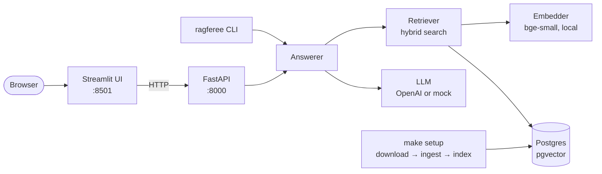

# ragferee

[](https://github.com/arabind-meher/ragferee/actions/workflows/ci.yml)

[](LICENSE)

Ask a football rules question and get a plain-language answer from the IFAB Laws of the Game 2026/27, with every
statement cited by Law, section and page so you can check it yourself.

ragferee is a retrieval-augmented generation (RAG) system that runs locally: it parses the official PDF, indexes it
in Postgres with pgvector, finds the relevant passages with hybrid search, and has an LLM answer only from those
passages. It comes with a chat UI, a web API and a command line.


## Features

- **Verifiable answers** – each statement cites its source as `[n]`, and every citation is taken from the passages
  that were retrieved, so the model can't invent a Law, section or page
- **Honest about gaps** – questions the Laws don't cover get "not covered" instead of a guess
- **Hybrid search** – vector and keyword search merged with weighted Reciprocal Rank Fusion
- **Measured, not guessed** – retrieval is scored on 63 hand-checked questions, with a held-out set to confirm tuning
- **Local by default** – embeddings run on your machine, every service listens on localhost only, and a mock LLM
  lets everything run without an API key
- **Three ways in** – Streamlit chat UI, FastAPI web API and a `ragferee` command line

## Quick start

You need [uv](https://docs.astral.sh/uv/) (it installs Python 3.13 for you), Docker with Docker Compose, and make.

```bash
git clone https://github.com/arabind-meher/ragferee.git
cd ragferee
make install
cp .env.example .env    # then fill in POSTGRES_USER and POSTGRES_PASSWORD
make db-up              # start Postgres with pgvector
make setup              # download the Laws, split them into chunks and index them
make run                # start the API and the chat UI
```

Open <http://localhost:8501> and ask a question, or pick one of the examples. The sidebar shows "API starting or
offline" for a few seconds while the API loads the embedding model. Press Ctrl+C to stop both.

`make setup` is needed once; it also downloads a 65 MB embedding model. Out of the box `LLM_PROVIDER=mock` gives
placeholder answers with real citations. For real answers, set `LLM_PROVIDER=openai` and `OPENAI_API_KEY` in
`.env` and restart `make run`.

## Configuration

Settings are read from `.env` and environment variables (environment variables win).
`uv run ragferee check` validates them and prints a summary without revealing secrets.

| Variable            | Required                 | Default      | Description        |
|---------------------|--------------------------|--------------|--------------------|
| `POSTGRES_USER`     | yes                      |              | Database user      |
| `POSTGRES_PASSWORD` | yes                      |              | Database password  |
| `POSTGRES_DB`       | no                       | `ragferee`   | Database name      |
| `POSTGRES_HOST`     | no                       | `localhost`  | Database host      |
| `POSTGRES_PORT`     | no                       | `5432`       | Database port      |
| `LLM_PROVIDER`      | no                       | `mock`       | `mock` or `openai` |
| `OPENAI_API_KEY`    | if `LLM_PROVIDER=openai` |              | OpenAI API key     |
| `OPENAI_MODEL`      | no                       | `gpt-5-mini` | OpenAI model       |

The chat UI only talks to the API, at `RAGFEREE_API_URL` (default `http://127.0.0.1:8000`), and needs none of
these settings.

## Architecture



| Module          | Responsibility                                                                  |
|-----------------|---------------------------------------------------------------------------------|
| `download.py`   | Download the official PDF and verify its SHA-256 checksum                       |
| `ingest.py`     | Parse Laws 1–17 into chunks, one per section per page, from font size and text  |
| `embeddings.py` | Embed text locally with fastembed                                               |
| `storage.py`    | Store chunks and embeddings in Postgres, with a generated full-text column      |
| `retrieval.py`  | Vector, keyword and hybrid search, merged with weighted Reciprocal Rank Fusion  |
| `llm.py`        | The `LLM` interface, with OpenAI and mock implementations                       |
| `answering.py`  | Build the prompt from numbered sources and turn `[n]` markers into citations    |
| `evaluation.py` | Hit rate and MRR over the question sets                                         |
| `api.py`        | FastAPI app: shared services created once at startup, routes and error handling |
| `ui.py`         | Streamlit chat page and its HTTP client for the API                             |
| `cli.py`        | The `ragferee` command                                                          |
| `config.py`     | Typed settings from `.env` and the environment (pydantic-settings)              |
| `models.py`     | Domain models: `Chunk`, `Citation`, `Answer`                                    |

Design choices:

- **Small interfaces, swappable parts.** `LLM`, `Embedder` and `Searcher` are `Protocol`s. The mock LLM runs the
  whole app without a key, and tests use simple fakes instead of mocking libraries.
- **One answering path.** The CLI and the API both use the same `Answerer`, so a question gets the same answer
  either way.
- **Citations by construction.** The model only refers to sources by number; the code maps those numbers back to
  the retrieved chunks and drops any that don't exist.
- **A thin UI.** The Streamlit page only makes HTTP calls to the API. It never touches the database or the model,
  and it needs no credentials.
- **Errors meant for people.** The API turns a failed LLM call into 502 and an unavailable database into 503; the
  UI turns those into messages that say what to do next.

## How it works

1. **Ingest** – PyMuPDF reads pages 44–151 (Laws 1–17). Laws and sections are detected from font size and text,
   giving one chunk per section per page, so every result can be cited exactly.
2. **Embed** – each chunk is embedded locally with `BAAI/bge-small-en-v1.5` (fastembed, 384 dimensions).
3. **Store** – chunks and embeddings live in Postgres with pgvector; a generated full-text column supports keyword
   search.
4. **Search** – a question is matched by meaning (cosine distance) and by keywords, and the two rankings are merged
   with weighted Reciprocal Rank Fusion; keyword results count for a quarter (see below).
5. **Answer** – the top chunks (5 by default) are sent to the LLM as numbered sources, with instructions to answer
   only from them and cite each statement as `[n]`. Those numbers are mapped back to the chunks' citations;
   unknown numbers are dropped, and the model replies "not covered" when the sources don't answer the question.
6. **Serve** – the FastAPI app loads the embedding model, LLM client and a Postgres connection pool once at
   startup, then answers each request with the same code as `ragferee ask`.
7. **Chat** – the Streamlit UI sends each question to `POST /ask` and shows the answer with a numbered list of
   sources, and the API's status and model from `GET /health`.

## Retrieval quality

Retrieval is measured with `uv run ragferee eval --compare` on two sets of hand-checked questions, many phrased in
everyday words such as "shin pads" or "linesman":

- `eval/retrieval.jsonl` – 36 questions covering all 17 Laws, used for tuning
- `eval/retrieval-holdout.jsonl` – 27 different questions, used only to confirm a tuning choice

| Mode                            | Main set (36)<br>Hit@1 / Hit@5 / MRR | Held-out set (27)<br>Hit@1 / Hit@5 / MRR |
|---------------------------------|--------------------------------------|------------------------------------------|
| Hybrid, equal weights (before)  | 0.69 / 0.92 / 0.80                   | 0.52 / 0.85 / 0.64                       |
| **Hybrid, keyword weight 0.25** | **0.75 / 0.97 / 0.83**               | **0.56 / 0.89 / 0.70**                   |
| Vector only                     | 0.64 / 0.97 / 0.77                   | 0.67 / 0.96 / 0.77                       |
| Keyword only                    | 0.50 / 0.72 / 0.59                   | 0.48 / 0.67 / 0.56                       |

Keyword search uses OR matching, so it matches most chunks (a median of 84 of 135 per question) and ranks them
noisily. With equal weights it pushed correct sections out of the top 5. Counting keyword results for a quarter,
and taking 50 candidates from each search instead of 20, improved hybrid search on both sets. The weight was chosen
on the main set for the best hit@5, since all top-5 chunks reach the LLM. Across all 63 questions, hybrid and
vector search now perform about the same: hybrid places the right section first slightly more often, and vector
search finds it in the top 5 slightly more often.

Tried, but didn't help:

- **Law and section header in the embedded text** – improved vector search on the main set (MRR 0.77 → 0.82) but
  made it worse on the held-out set (0.77 → 0.72): chunks from the same Law started to look alike. Reverted.
- **Cover-density ranking (`ts_rank_cd`)** – keyword hit@5 on the main set fell from 0.72 to 0.42.
- **Section and Law titles weighted in the keyword index** – keyword hit@5 fell to 0.53.
- **Length-normalised `ts_rank`** – better for keyword search alone (hit@5 0.83), no gain in hybrid search.

Known weak spots: everyday words that the Laws don't use ("linesman" for assistant referee, "game" for match),
and tables in the PDF, such as pitch dimensions, which extract poorly.

## Web API

`make run` starts the API on port 8000 next to the UI; `uv run ragferee serve` starts it on its own. Interactive
documentation is at <http://localhost:8000/docs>.

```bash
curl -s localhost:8000/ask -H 'Content-Type: application/json' \
     -d '{"question": "Can a player be offside from a throw-in?"}'
```

```json
{
  "text": "No — there is no offside offence if a player receives the ball directly from a throw-in [1]. …",
  "citations": [
    {"law_number": 11, "section": "3. No offence", "page": 111},
    {"law_number": 11, "section": "1. Offside position", "page": 109}
  ]
}
```

| Endpoint      | What it does                                                                       |
|---------------|------------------------------------------------------------------------------------|
| `POST /ask`   | Answer `{"question": "...", "limit": 5}`; `[n]` in the text is `citations[n-1]`    |
| `GET /health` | Report the indexed chunk count and the model; 503 if the database is down or empty |
| `GET /docs`   | Interactive API documentation                                                      |

`question` must be 1–500 characters and `limit` (the number of Law passages to answer from) 1–20. Invalid input
returns 422, a failed LLM request 502, and an unavailable database 503.

## Command line

The `ragferee` command is the tool behind `make setup` and `make run`. It is also useful on its own for asking from
the terminal, inspecting search results and measuring retrieval quality.

```bash
uv run ragferee ask "What happens if a goalkeeper holds the ball too long?"
```

```text
If a goalkeeper inside their penalty area controls the ball with their hand(s)/arm(s) for more than eight
seconds before releasing it, the opposing team is awarded a corner kick [1]. The referee decides when the
goalkeeper's control begins and will visually count down the last five seconds with a raised hand [1]. …

Sources:
[1] Law 12, 3. Corner kick, p. 119
```

To see the retrieved chunks themselves, search instead:

```bash
uv run ragferee search "What happens if a goalkeeper holds the ball too long?"
```

```text
1. Law 12, 3. Corner kick, p. 119  (0.0323)
   A corner kick is awarded if a goalkeeper, inside their penalty area, controls the ball with their …
2. Law 12, 1. Direct free kick, p. 116  (0.0320)
   …
```

| Command                             | What it does                                         |
|-------------------------------------|------------------------------------------------------|
| `check`                             | Validate settings without revealing secrets          |
| `download [--force]`                | Download the PDF and verify its checksum             |
| `ingest`                            | Parse the PDF into chunks                            |
| `index`                             | Embed the chunks and store them in Postgres          |
| `search "<question>" [--limit N]`   | Show the most relevant chunks with citations         |
| `ask "<question>" [--limit N]`      | Answer a question, citing Law, section and page      |
| `eval [--compare] [--file PATH]`    | Measure retrieval quality (`--help` for all options) |
| `serve [--host HOST] [--port PORT]` | Run the web API (default `127.0.0.1:8000`)           |

## Development

| Command                       | What it does                                   |
|-------------------------------|------------------------------------------------|
| `make install`                | Install dependencies                           |
| `make setup`                  | Download, parse and index the Laws             |
| `make run`                    | Start the API and the chat UI                  |
| `make lint`                   | Ruff lint, Ruff format check and mypy (strict) |
| `make format`                 | Format and auto-fix lint issues                |
| `make test`                   | Run the test suite                             |
| `make hooks`                  | Run the pre-commit checks on all files         |
| `make db-up` / `make db-down` | Start / stop Postgres with pgvector            |

The tests need no API key or network: the LLM, search and HTTP calls are replaced with fakes, and the chat page is
tested headless with Streamlit's `AppTest`. Storage, retrieval, evaluation and health-check tests use Postgres and are skipped
when it isn't running. CI runs lint, type checks and the full suite against a pgvector service on every push.

To work on the chat UI, run the API and the UI in two terminals, with reload on save turned on:

```bash
uv run ragferee serve
uv run streamlit run src/ragferee/ui.py --server.fileWatcherType auto
```

Streamlit settings (local address, port 8501, no usage statistics) are in `.streamlit/config.toml`.

Pre-commit hooks run the same checks as `make lint` on every commit:

```bash
uv run pre-commit install
```

## Data

The IFAB Laws of the Game are not included in this repository; `make setup` downloads the official PDF from IFAB.
Everything under `data/` (the PDF, parsed chunks and the embedding model) is ignored by git. ragferee is not an
official IFAB product, and its answers are not a substitute for the Laws themselves.

## Author

**Arabind Meher**

[LinkedIn](https://www.linkedin.com/in/arabind-meher/) | [GitHub](https://github.com/arabind-meher)
<br>
arabindmeher.99@gmail.com

## License

[MIT](LICENSE)
